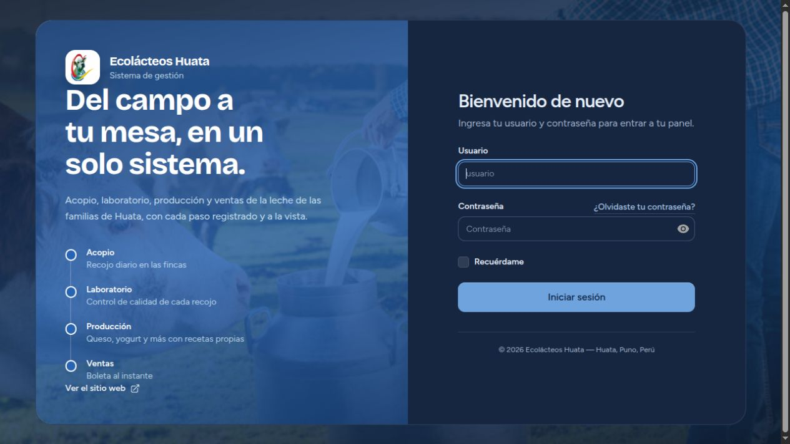
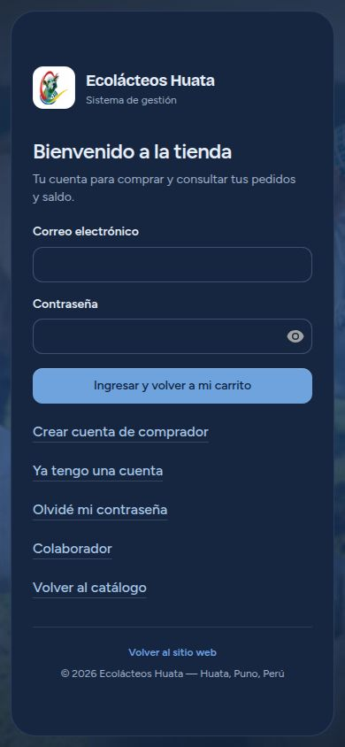

# Restauración selectiva del diseño web original

Entrega: 27 de octubre de 2026, zona America/Lima.

## Referencia y checkpoint

- Raíz Git: `/home/willian/Desarrollo/Huata`.
- Origen: `https://github.com/Kazuto1253/Empresa-de-Leche.git`.
- Rama clonada y de trabajo: `web-laravel-huata`.
- Commit de referencia: `0fd6a98e3010187a041baa1ce60cf79333f582d4`.
- Evidencia: el reflog registra la clonación de esa rama/HEAD el 25/10/2026 a las 21:50:03, UTC−05. Se utilizó ese estado local verificable, sin adoptar cambios posteriores del remoto.
- Checkpoint: `/home/willian/Desarrollo/Huata.zip`. Se comprobó íntegramente mediante CRC, sin errores, antes de modificar fuentes. Los 219 archivos modificados o no rastreados presentes al inicio estaban incluidos y coincidían byte a byte. No se sobrescribió ni extrajo el checkpoint sobre el proyecto.

El repositorio ya contenía avances funcionales sin commit. Se conservan sus archivos y su estado Git. No se realizó reset, clean, checkout, restore general, merge, commit ni push.

## Cambios efectivamente aplicados

Solo se modificaron estas tres plantillas de la aplicación, comparadas con el checkpoint anterior a esta tarea:

| Archivo dentro de Laravel | Restauración visual | Funcionalidad conservada |
|---|---|---|
| `resources/views/layouts/app/sidebar.blade.php` | Recupera la etiqueta original del área para roles históricos: Administración, Planta, Acopio, Proveedor, Ventas y Producción. | Mantiene nombres de roles personalizados, navegación dinámica, buscador y restricciones vigentes. |
| `resources/views/pages/admin/⚡asignar-roles.blade.php` | Recupera la distinción original de insignias: rol principal verde y adicionales zinc. | Mantiene catálogo dinámico, selección múltiple, asignaciones y protecciones actuales. |
| `resources/views/clientes-web/pago.blade.php` | Recupera el panel Yape del diseño original: fondo `#742284`, bordes redondeados, título, importe y ancho máximo del QR. La imagen conserva su proporción. | Conserva el QR del receptor asignado y muestra el panel bajo las mismas condiciones previas de disponibilidad e intención canónica. Mantiene código, consulta, estados, pago posterior y protección contra falsas confirmaciones. |

Raíz de esas rutas: `/home/willian/Desarrollo/Huata/laravelEcolacteosHuata`.

No se sustituyeron plantillas completas por sus versiones antiguas. Los bloques PHP del componente de asignación, el cálculo de navegación del sidebar, las condiciones de admisión del pago y su JavaScript permanecen idénticos al checkpoint. El nuevo importe visible del panel usa el importe de la intención existente; no introduce otro cálculo financiero.

Se agregan este informe y tres capturas en `docs/evidencias-restauracion-web/` como evidencias de la entrega.

## Elementos que ya conservaban el diseño del clon

No correspondía sobrescribir recursos que ya eran originales. Se confirmó que coinciden con la referencia los tres archivos CSS, los siete JavaScript y las diez imágenes/referencias visuales rastreadas examinadas, además de seis layouts, veintidós componentes y sesenta y tres vistas rastreadas. Las restantes diferencias se revisaron como integración funcional previa, sin revertirlas globalmente.

`resources/views/welcome.blade.php` no fue modificado por esta restauración. Sus secciones de hero, vitrina 3D, historia, tarjetas de productos, proceso y contacto conservan la estructura de la referencia. En productos se mantiene el texto actualizado que describe la compra desde una cuenta. Las diferencias previas del encabezado enlazan al acceso/cuenta del comprador; el checkout conserva autenticación, teléfono editable, saldo, receptor dinámico y guardado del pedido.

También se conserva la corrección previa de scroll del carrito que evita ocultar sus líneas cuando crece el checkout. No se recuperó el QR hardcodeado ni el flujo antiguo que pedía pagar antes de crear una intención segura.

## Funciones y diferencias visuales necesarias que permanecen

- Roles dinámicos, selección múltiple, distribuciones, asignaciones, Teams y restricciones de navegación permanecen. Los nuevos nombres y accesos autorizados siguen apareciendo.
- Las pantallas nuevas de roles, distribuciones, compradores y configuración de pagos siguen presentes y usan los componentes actuales de Huata. No se eliminaron directorios nuevos.
- Se conservan controles de cuentas central/personal/compartida, verificación, vinculación revocable y descarga de Bridge.
- El comprador conserva acceso separado del personal, carrito, checkout, Mi cuenta, pedidos guardados y pagar después. El enlace Colaborador continúa apuntando al login del personal.
- La información de estado, disponibilidad y receptor asignado se mantiene aunque no existiera en el proyecto clonado. No se presentan imágenes de pago operativo fuera de las condiciones seguras existentes.
- Se mantienen las preferencias de apariencia ya disponibles; no se impuso otro tema, color global, fondo, fuente ni distribución general.

## Verificaciones

**Pruebas focalizadas: 167 aprobadas, 854 aserciones, cero fallos.** Se ejecutaron con SQLite `:memory:`, sesión/cache de pruebas y sin usar la base operativa. Incluyen acceso por roles, módulos del administrador, autorización dinámica, integración de formularios de usuarios, distribuciones, compradores, pagos canónicos, receptores, inscripción de Bridge y autenticación. Log: `/tmp/huata-restauracion-pruebas.log`.

`git diff --check` terminó sin errores. El manifiesto previo de fuentes confirma que los únicos archivos existentes editados por esta tarea son los tres Blade indicados y que ningún archivo previo fue eliminado. No hubo cambios adicionales en código después de estas pruebas.

### Comprobación visual

Se prepararon dos copias temporales independientes en `/tmp/huata-restauracion-visual/`: una del commit original y otra del estado restaurado, con dependencias locales copiadas y SQLite ficticias. Las migraciones y el seeder utilizados para esa comparación se ejecutaron exclusivamente en esas copias temporales. No se instalaron dependencias ni se migró la instalación operativa.

- Login del personal: capturas original/restaurada de **1265 × 712 píxeles, idénticas píxel por píxel**.
- Acceso comprador: comprobado en viewport de **390 × 844**, ancho de documento de 390 px, sin desbordamiento horizontal. Se verificaron formulario, enlaces y Colaborador; no se registraron errores de consola en esa comprobación.
- Portada: se inspeccionó inicialmente, pero la escena 3D bloqueó los intentos posteriores de captura automatizada. No se declara una comparación completa de píxeles de la portada ni de sus animaciones. Su comparación de estructura, estilos, scripts e imágenes está documentada arriba.
- Paneles y pantallas autenticadas: el usuario indicó continuar sin login visual después del bloqueo de aprobación automática. Se verificaron mediante comparación de fuentes y pruebas PHP; no se afirma haber completado capturas autenticadas ni validación visual manual de todas sus operaciones.
- Por esa misma limitación, el panel QR restaurado fue verificado en plantilla y pruebas, sin una captura autenticada ni un pago real.

Evidencias:

## Datos y alcance protegido

No se editaron controladores, servicios, modelos, políticas, rutas, autenticación, migraciones, credenciales ni variables de entorno. Tampoco se editaron Kotlin, APK, Payment Core o Yape Bridge, ni se compilaron o instalaron aplicaciones Android.

La comparación final de todas las tablas con la copia del checkpoint confirmó contenido idéntico en identidad, autorización y negocio. **El archivo SQLite completo no tiene un hash idéntico:** durante la actividad normal de consulta pública hubo variaciones en `cache` y `sessions` (de dos a tres sesiones). No se ejecutó DML manual ni migraciones sobre esa base y no se revirtieron esas entradas de ejecución. Por tanto, esta entrega no afirma identidad binaria de la base operativa.

## Cierre de servidores temporales

Antes de cerrarlos se comprobaron comando completo, directorio y puerto:

| PID temporal | Escucha | Directorio verificado |
|---|---|---|
| 140268 | `127.0.0.1:18080` | `/tmp/huata-restauracion-visual/original/laravelEcolacteosHuata` |
| 140330 | `127.0.0.1:18081` | `/tmp/huata-restauracion-visual/actual/laravelEcolacteosHuata` |

Se envió SIGTERM únicamente a esos dos procesos, tras volver a validar su identidad. La verificación posterior confirmó ambos procesos cerrados y ambos puertos sin escucha.

Se conservaron Laravel, PID 106909, en `0.0.0.0:8000`, y Core, PID 134239, en loopback `127.0.0.1:8087`. No se reinició ningún servicio operativo ni se intervino Scheduler.

La restauración queda aplicada selectivamente. La validación visual completa de portada 3D y pantallas autenticadas sigue siendo una limitación explícita; no se amplió el alcance para corregir el navegador o modificar funcionalidades.
