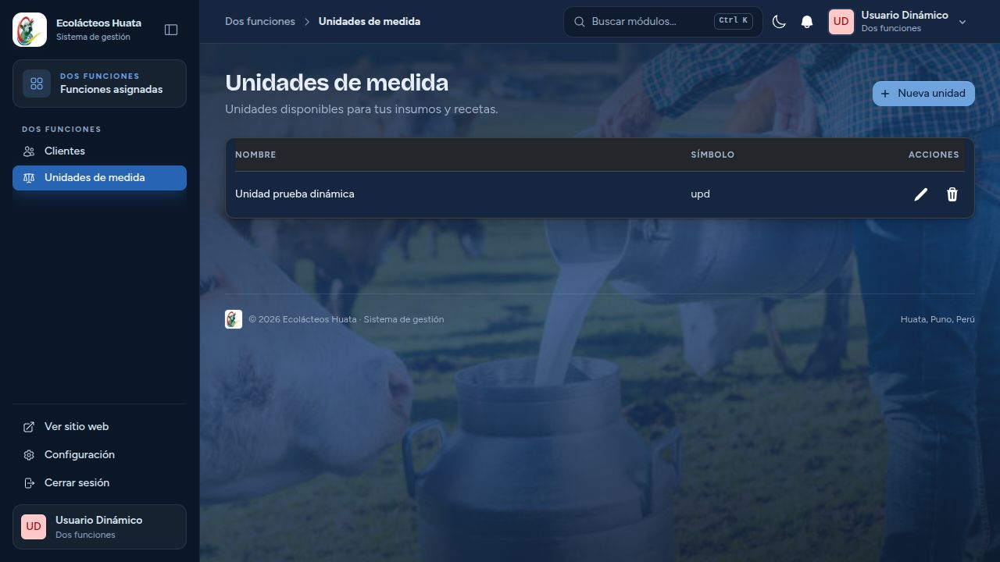

# Roles y funciones dinámicas — implementación y validación

Fecha: 26 de octubre de 2026. Rama de trabajo: `web-laravel-huata`.

Actualización focalizada: [integración de usuarios y administración Android](CORRECCION_ROLES_USUARIOS_ANDROID.md).

## Resultado implementado

Laravel administra los roles y las funciones. Se registraron **41 pantallas funcionales**, con **39 correspondencias nativas Android**. Cada identificador concede las operaciones ordinarias ya implementadas en esa pantalla; no se añadieron permisos CRUD artificiales ni endpoints ejecutables definidos desde datos.

Las dos funciones exclusivamente web son `vendedor.pedidos-web` y `vendedor.configuracion-pagos`. `admin.roles` dispone ahora de su pantalla nativa `AdminRoles`. El formulario indica esa diferencia; no se crearon WebViews ni pantallas móviles ficticias.

Se conservan los seis roles tradicionales y sus categorías de negocio. `users.rol` y `users.roles` mantienen esas categorías y los perfiles asociados, pero no autorizan las pantallas. Los roles nuevos viven en la relación central y se conservan como identificadores de texto en Android. La asignación heredada «Tomar asistencia» se importa como registro auxiliar central; no obliga a cambiar de rol para usarla.

## Uso

1. Entrar como administrador autorizado y abrir **Configuración → Roles y funciones**, ruta `{current_team}/admin/roles`.
2. Crear o editar un rol, activar/desactivar su estado y seleccionar las funciones existentes.
3. Usar **Asignar rol a usuarios**, en su pantalla habitual. Permite varios roles y retirarlos; una cuenta sin funciones queda sin acceso a módulos.
4. Android descarga la misma configuración al ingresar y al sincronizar. Su selector muestra roles dinámicos; el contenido utiliza los hosts y pantallas Compose originales.

La pantalla móvil de asignación que ya existía consulta el catálogo central y envía su operación a Laravel. Requiere conexión: no concede privilegios independientes en SQLite. Crear roles o configurar sus funciones se hace desde Laravel o desde la pantalla nativa «Roles y funciones», mediante la misma API central y siempre con conexión.

## Persistencia y controles

- `authorization_roles`: código estable, nombre, activo, protegido y lista de identificadores de pantalla validada contra el catálogo de código.
- `authorization_role_user`: relación entre usuarios del personal y roles.
- `authorization_state`: revisión y administrador principal protegido; serializa cambios sensibles.
- `authorization_audit`: actor, acción, objeto, antes/después y fecha.
- Android: `autorizacion_local`, `autorizacion_pantalla`, `autorizacion_sesion`, `cambio_revision` y marcador `autorizacion_migracion`; `cambio_pendiente` incorpora el autor.

La migración Laravel `2026_10_26_200000_create_central_authorization.php` está aplicada. La equivalencia de accesos de los **12 usuarios existentes** fue comprobada. No se cambiaron sus identificadores, contraseñas ni pertenencias originales.

`EnsureRole` conserva su nombre para compatibilidad de rutas, pero verifica la pantalla registrada. Los argumentos históricos de sus rutas no otorgan acceso. Los hooks de componentes comprueban autorización en montaje, hidratación y acciones; también persisten los middleware de pertenencia a equipos. La API comprueba cada operación y sus condiciones contextuales.

Los accesos son globales a la asociación, conforme al modelo comercial existente. Teams continúa controlando pertenencias y sus políticas; no se convirtió el proyecto en multiempresa. Las consultas personales de acopiadores/proveedores y asistencia se filtran también en datos e IDs del sync, incluidos los incrementales.

La definición protegida del administrador, su cuenta principal y su pertenencia al equipo operativo no se pueden retirar accidentalmente. Los administradores históricos conservan la delegación que ya tenían. Los administradores delegados no pueden otorgar funciones fuera de su alcance ni gestionar credenciales de una cuenta superior. Las operaciones financieras sensibles conservan sus condiciones de propiedad y verificación, y requieren administración crítica cuando corresponde.

## Contrato móvil

| Operación | Contrato |
|---|---|
| `POST /api/mobile/login` | Devuelve token y `autorizacion`, además de las categorías heredadas y datos de cuenta existentes. |
| `GET /api/mobile/autorizaciones` | Bearer token activo; snapshot antes de subir pendientes. |
| `GET /api/mobile/sync?since=...` | Incluye siempre la autorización actual, independientemente de `since`; limita tablas e IDs a las consultas autorizadas y sus dependencias. |
| `POST /api/mobile/autorizaciones/asignar` | `usuario_id` y `roles` (códigos); exige la función de asignación y el alcance de delegación. No existe autoasignación libre. |
| `POST /api/mobile/cambios` | Autoriza la tabla/operación y las reglas de negocio; nunca confía en los roles enviados en la fila del usuario. |

El snapshot contiene `usuario_id`, `version`, `roles` (código, nombre, activo, auxiliar y pantallas), `pantallas`, `pantallas_adicionales`, `categorias_historicas`, `mapeo_android` y política offline. El catálogo de roles delegables se incluye cuando el actor puede asignarlos.

El APK nuevo envía `X-Huata-Authorization-Protocol: 1` al subir cambios. Recibe rechazos parciales con datos para revisión. Una APK anterior sin ese protocolo recibe **HTTP 409 y rollback de todo el lote si existe un rechazo**: su código anterior lanza error antes de borrar la cola. No se acusa recibo de cambios rechazados mediante un HTTP 200 que esa versión interpretaría incorrectamente.

## Offline y revocación

La migración SQLite pasa de versión 20 a 21 sin borrar tablas de negocio ni la cola existente. La apertura ya no elimina la base del teléfono ante un error de migración.

Al actualizar una instalación antigua, un marcador permite importar **una sola vez** los accesos offline que su APK anterior ya conocía. Se guardan como snapshot `heredada-v20`, no como comprobaciones de roles durante la ejecución. La primera respuesta central los sustituye y el marcador impide reactivar permisos heredados después. Una instalación nueva no ejecuta esa importación.

Sin conexión se usa la última autorización conocida. No se promete revocación instantánea sin red. Al reconectar, el APK actualiza las asignaciones antes de subir trabajo; el servidor vuelve a verificar permisos vigentes. Las escrituras locales también tienen guardas de autorización en SQLite.

Los rechazos se copian íntegramente a `cambio_revision` antes de aplicar datos del servidor. Conservan operación, contenido, autor, versión conocida al revisar, motivo y fecha; esto no constituye prueba de pago. Los pendientes de otra cuenta no se envían con el token actual. Los pendientes antiguos sin autor se conservan para revisión administrativa y se avisa de esa situación.

El panel de sincronización existente permite consultar y copiar el trabajo conservado: el autor ve el suyo y la administración crítica puede revisar el conjunto. Los hashes de contraseña y tokens no se muestran. No se reenvían automáticamente los rechazos ni se los transforma en ventas/pagos confirmados.

## Mapeo completo

El catálogo ejecutable es `app/Authorization/Pantallas.php`; la correspondencia nativa está en `presentation/navigation/RootAutorizado.kt`. Las pruebas contrastan las 39 correspondencias del contrato real.

| Identificador común / nombre de ruta | Función | URL web existente | Screen Android |
|---|---|---|---|
| `admin.panel` | Administración · Panel | `{current_team}/admin/panel` | `AdminDashboard` |
| `admin.usuarios` | Administración · Usuarios | `{current_team}/admin/usuarios` | `AdminUsuarios` |
| `admin.asignar-roles` | Administración · Asignar rol a usuarios | `{current_team}/admin/asignar-roles` | `AdminAsignarRoles` |
| `admin.descuentos` | Administración · Descuentos | `{current_team}/admin/descuentos` | `AdminDescuentos` |
| `admin.precios` | Administración · Precios de la leche | `{current_team}/admin/precios` | `AdminPrecios` |
| `planta.rutas` | Planta · Rutas | `{current_team}/planta/rutas` | `PlantaRutas` |
| `admin.turnos` | Administración · Turnos de rutas y turnos de producción | `{current_team}/admin/turnos` | `AdminTurnos` |
| `admin.empresa` | Administración · Empresa | `{current_team}/admin/empresa` | `AdminEmpresa` |
| `vendedor.configuracion-pagos` | Ventas · Configuración de pagos | `{current_team}/vendedor/configuracion-pagos` | Solo web; no existe pantalla nativa |
| `asistencia.tomar` | Asistencia · Tomar asistencia | `{current_team}/asistencia/tomar` | `TomarAsistencia` |
| `vendedor.pedidos-web` | Ventas · Compras por web | `{current_team}/vendedor/pedidos-web` | Solo web; no existe pantalla nativa |
| `planta.comunicados` | Planta · Comunicados | `{current_team}/planta/comunicados` | `PlantaComunicados` |
| `planta.panel` | Planta · Panel | `{current_team}/planta/panel` | `PlantaDashboard` |
| `planta.laboratorio` | Planta · Laboratorio | `{current_team}/planta/laboratorio` | `PlantaLaboratorio` |
| `planta.entregas` | Planta · Entregas de acopiadores | `{current_team}/planta/entregas` | `PlantaRecepcion` |
| `planta.pagos` | Planta · Pago a proveedores | `{current_team}/planta/pagos` | `PlantaPagos` |
| `asistencia.mis` | Asistencia · Asistencia | `{current_team}/asistencia/mis-asistencias` | `MiAsistencia` |
| `acopiador.panel` | Acopio · Panel | `{current_team}/acopiador/panel` | `AcopiadorDashboard` |
| `acopiador.recojo` | Acopio · Recojo de ruta | `{current_team}/acopiador/recojo` | `AcopiadorRecojo` |
| `acopiador.mapa-recojo` | Acopio · Mapa de recojo | `{current_team}/acopiador/mapa-recojo` | `AcopiadorMapaRecojo` |
| `acopiador.entrega` | Acopio · Entrega a planta | `{current_team}/acopiador/entrega` | `AcopiadorEntrega` |
| `acopiador.inventario` | Acopio · Inventario | `{current_team}/acopiador/inventario` | `AcopiadorInventario` |
| `proveedor.panel` | Proveedor · Panel | `{current_team}/proveedor/panel` | `ProveedorDashboard` |
| `proveedor.entregas` | Proveedor · Mis entregas | `{current_team}/proveedor/entregas` | `ProveedorEntregas` |
| `proveedor.laboratorio` | Proveedor · Laboratorio | `{current_team}/proveedor/laboratorio` | `ProveedorLaboratorio` |
| `proveedor.comunicados` | Proveedor · Comunicados | `{current_team}/proveedor/comunicados` | `ProveedorComunicados` |
| `vendedor.panel` | Ventas · Panel | `{current_team}/vendedor/panel` | `VendedorDashboard` |
| `vendedor.ventas` | Ventas · Venta | `{current_team}/vendedor/ventas` | `VendedorVenta` |
| `vendedor.produccion` | Ventas · Productos | `{current_team}/vendedor/produccion` | `VendedorProductos` |
| `vendedor.historial` | Ventas · Historial de ventas | `{current_team}/vendedor/historial` | `VendedorHistorialVentas` |
| `vendedor.clientes` | Ventas · Clientes | `{current_team}/vendedor/clientes` | `VendedorClientes` |
| `vendedor.inventario` | Ventas · Inventario | `{current_team}/vendedor/inventario` | `VendedorInventario` |
| `produccion.panel` | Producción · Panel | `{current_team}/produccion/panel` | `ProduccionDashboard` |
| `produccion.registros` | Producción · Producción | `{current_team}/produccion/registros` | `ProduccionRegistros` |
| `produccion.recetas` | Producción · Recetas | `{current_team}/produccion/recetas` | `ProduccionRecetas` |
| `produccion.insumos` | Producción · Insumos | `{current_team}/produccion/insumos` | `ProduccionInsumos` |
| `produccion.unidades` | Producción · Unidades de medida | `{current_team}/produccion/unidades` | `ProduccionUnidades` |
| `produccion.productos` | Producción · Productos | `{current_team}/produccion/productos` | `ProduccionProductos` |
| `produccion.compras` | Producción · Compras | `{current_team}/produccion/compras` | `ProduccionCompras` |
| `produccion.inventario` | Producción · Inventario | `{current_team}/produccion/inventario` | `ProduccionInventario` |
| `admin.roles` | Administración · Roles y funciones | `{current_team}/admin/roles` | `AdminRoles` |

El perfil propio, cierre de sesión, conexión/sincronización y notificaciones conservan sus controles de identidad; las acciones de Teams conservan sus políticas. No son privilegios administrativos otorgados por ocultar un menú.

Las rutas auxiliares de boletas, PDFs y detalles usan la pantalla correspondiente y sus reglas contextuales; no se crean permisos separados para abrir un documento perteneciente a una operación autorizada.

## Validación realizada

- Laravel/API: **428 pruebas aprobadas, 1767 aserciones**; base de pruebas SQLite en memoria.
- Kotlin/Android host: **56 pruebas aprobadas**, incluyendo SQLite real, las 39 correspondencias, roles desconocidos para el enum, uso de ambas funciones del usuario de prueba, revocación, reinicio de caché, cola de otra sesión, migración 20→21 y conservación de pendientes.
- Mismo usuario y rol `dos_funciones`: Clientes + Unidades, contrato exportado por las pruebas Laravel y consumido por las pruebas Kotlin; operaciones originales de ambos repositorios comprobadas.
- Web visual: ambos formularios guardan en SQLite aislado; menú limitado a las dos funciones; escritorio y viewport 390×844 sin desbordamiento global. Modal central responsive con componentes actuales.
- Vite y caché Blade compilados; APK debug compilado. Advertencias no fatales del empaquetador sobre tamaño de chunks y metadatos Kotlin/D8; no se actualizaron dependencias para ocultarlas.
- Servicios existentes conservados; `/up`, `/login` y `/mi-cuenta/ingresar` responden HTTP 200. No se reiniciaron.

APK: `EcolacteosHuata/androidApp/build/outputs/apk/debug/androidApp-debug.apk`.

**Pendiente operativo:** ejecutar la versión compilada en el teléfono y verificar sus pantallas y reconexión allí. No se instaló/reinstaló una APK ni se borraron datos del dispositivo. Las pruebas host no se presentan como una prueba física en el teléfono. Esta tarea tampoco certifica un pago bancario real ni habilita receptores.

## Conservación y corrección de la prueba visual

La copia previa al DDL falló por el nombre de una tabla y la migración aditiva se ejecutó. No se presenta una copia posterior como respaldo previo a la migración. La copia consistente posterior al DDL y anterior a la prueba visual está en `storage/app/private/roles-dinamicos/20261026-post-migracion.json`, modo 0600 e ignorada por Git.

El primer arranque de la prueba visual conservó una conexión SQLite anterior al cambio de configuración: creó dos usuarios de prueba (IDs 13/14), su rol y una unidad en la base principal. Se retiraron exclusivamente esos registros propios. Se comprobó igualdad exacta de todos los registros anteriores de usuarios, equipos, membresías y autorización contra la copia anterior a esa prueba; las secuencias autoincrementales no se retrocedieron. No se reescribieron registros preexistentes para efectuar la limpieza.

La prueba visual se repitió con `DB::purge('sqlite')` y comprobación obligatoria de `getDatabaseName()` antes de migrar, sembrar o atender peticiones. Sus datos y servidor estuvieron en `/tmp/huata-roles-ui`, separados del servicio real. Las imágenes adjuntas corresponden a esa repetición aislada.

## Archivos implicados

La implementación conserva los cambios locales de pagos que ya existían. No se modificaron Payment Core ni Yape Bridge, los diseños globales, el login del comprador, el del personal o la página pública. Las autorizaciones Laravel de cobros/saldos se adaptaron sin cambiar la conciliación canónica ni sus condiciones de PAID. La elegibilidad del responsable de pedidos web se consulta mediante `vendedor.pedidos-web`; el cobro presencial exige `vendedor.ventas`. La configuración de receptores se consulta mediante `vendedor.configuracion-pagos`. En todos los casos siguen siendo obligatorias las verificaciones técnicas del receptor y del QR; la pertenencia a un rol nuevo no verifica ni habilita un receptor.

- `EcolacteosHuata/shared/src/androidHostTest/kotlin/com/example/ecolacteoshuata/authorization/AutorizacionMultiplataformaTest.kt`
- `EcolacteosHuata/shared/src/androidHostTest/kotlin/com/example/ecolacteoshuata/authorization/SqliteTestDriver.kt`
- `EcolacteosHuata/shared/src/androidHostTest/resources/huata-auth-contract.json`
- `EcolacteosHuata/shared/src/androidHostTest/resources/huata-auth-revoked.json`
- `EcolacteosHuata/shared/src/androidMain/kotlin/com/example/ecolacteoshuata/data/local/DatabaseDriverFactory.android.kt`
- `EcolacteosHuata/shared/src/commonMain/kotlin/com/example/ecolacteoshuata/App.kt`
- `EcolacteosHuata/shared/src/commonMain/kotlin/com/example/ecolacteoshuata/data/local/MigracionAutorizacionHeredada.kt`
- `EcolacteosHuata/shared/src/commonMain/kotlin/com/example/ecolacteoshuata/data/mapper/AuthMapper.kt`
- `EcolacteosHuata/shared/src/commonMain/kotlin/com/example/ecolacteoshuata/data/remote/datasource/SyncRemoteDataSource.kt`
- `EcolacteosHuata/shared/src/commonMain/kotlin/com/example/ecolacteoshuata/data/remote/dto/AuthDtos.kt`
- `EcolacteosHuata/shared/src/commonMain/kotlin/com/example/ecolacteoshuata/data/remote/dto/SyncDtos.kt`
- `EcolacteosHuata/shared/src/commonMain/kotlin/com/example/ecolacteoshuata/data/repository/AutorizacionLocal.kt`
- `EcolacteosHuata/shared/src/commonMain/kotlin/com/example/ecolacteoshuata/data/repository/SessionRepositoryImpl.kt`
- `EcolacteosHuata/shared/src/commonMain/kotlin/com/example/ecolacteoshuata/data/repository/UsuarioRepositoryImpl.kt`
- `EcolacteosHuata/shared/src/commonMain/kotlin/com/example/ecolacteoshuata/data/sync/IdentidadUsuario.kt`
- `EcolacteosHuata/shared/src/commonMain/kotlin/com/example/ecolacteoshuata/data/sync/RegistroCambios.kt`
- `EcolacteosHuata/shared/src/commonMain/kotlin/com/example/ecolacteoshuata/data/sync/SyncService.kt`
- `EcolacteosHuata/shared/src/commonMain/kotlin/com/example/ecolacteoshuata/di/DataModule.kt`
- `EcolacteosHuata/shared/src/commonMain/kotlin/com/example/ecolacteoshuata/di/DatabaseModule.kt`
- `EcolacteosHuata/shared/src/commonMain/kotlin/com/example/ecolacteoshuata/di/DomainModule.kt`
- `EcolacteosHuata/shared/src/commonMain/kotlin/com/example/ecolacteoshuata/di/ViewModelModule.kt`
- `EcolacteosHuata/shared/src/commonMain/kotlin/com/example/ecolacteoshuata/domain/model/AutorizacionUsuario.kt`
- `EcolacteosHuata/shared/src/commonMain/kotlin/com/example/ecolacteoshuata/domain/model/Usuario.kt`
- `EcolacteosHuata/shared/src/commonMain/kotlin/com/example/ecolacteoshuata/domain/model/UsuarioRemoto.kt`
- `EcolacteosHuata/shared/src/commonMain/kotlin/com/example/ecolacteoshuata/domain/repository/UsuarioRepository.kt`
- `EcolacteosHuata/shared/src/commonMain/kotlin/com/example/ecolacteoshuata/domain/usecase/AuthUseCases.kt`
- `EcolacteosHuata/shared/src/commonMain/kotlin/com/example/ecolacteoshuata/domain/usecase/CrudUsuarioUseCases.kt`
- `EcolacteosHuata/shared/src/commonMain/kotlin/com/example/ecolacteoshuata/presentation/acopiador/AcopiadorRootScreen.kt`
- `EcolacteosHuata/shared/src/commonMain/kotlin/com/example/ecolacteoshuata/presentation/acopiador/AcopiadorRootViewModel.kt`
- `EcolacteosHuata/shared/src/commonMain/kotlin/com/example/ecolacteoshuata/presentation/admin/AdminRootScreen.kt`
- `EcolacteosHuata/shared/src/commonMain/kotlin/com/example/ecolacteoshuata/presentation/admin/roles/AdminAsignarRolesScreen.kt`
- `EcolacteosHuata/shared/src/commonMain/kotlin/com/example/ecolacteoshuata/presentation/admin/roles/AdminAsignarRolesViewModel.kt`
- `EcolacteosHuata/shared/src/commonMain/kotlin/com/example/ecolacteoshuata/presentation/admin/usuarios/AdminUsuariosScreen.kt`
- `EcolacteosHuata/shared/src/commonMain/kotlin/com/example/ecolacteoshuata/presentation/common/RootScaffold.kt`
- `EcolacteosHuata/shared/src/commonMain/kotlin/com/example/ecolacteoshuata/presentation/common/SelectorRol.kt`
- `EcolacteosHuata/shared/src/commonMain/kotlin/com/example/ecolacteoshuata/presentation/common/conexion/ConexionSyncSheet.kt`
- `EcolacteosHuata/shared/src/commonMain/kotlin/com/example/ecolacteoshuata/presentation/common/conexion/ConexionSyncViewModel.kt`
- `EcolacteosHuata/shared/src/commonMain/kotlin/com/example/ecolacteoshuata/presentation/navigation/RootAutorizado.kt`
- `EcolacteosHuata/shared/src/commonMain/kotlin/com/example/ecolacteoshuata/presentation/planta/PlantaRootScreen.kt`
- `EcolacteosHuata/shared/src/commonMain/kotlin/com/example/ecolacteoshuata/presentation/produccion/ProduccionRootScreen.kt`
- `EcolacteosHuata/shared/src/commonMain/kotlin/com/example/ecolacteoshuata/presentation/proveedor/ProveedorRootScreen.kt`
- `EcolacteosHuata/shared/src/commonMain/kotlin/com/example/ecolacteoshuata/presentation/proveedor/ProveedorRootViewModel.kt`
- `EcolacteosHuata/shared/src/commonMain/kotlin/com/example/ecolacteoshuata/presentation/vendedor/VendedorRootScreen.kt`
- `EcolacteosHuata/shared/src/commonMain/sqldelight/com/example/ecolacteoshuata/db/20.sqm`
- `EcolacteosHuata/shared/src/commonMain/sqldelight/com/example/ecolacteoshuata/db/AutorizacionLocal.sq`
- `EcolacteosHuata/shared/src/commonMain/sqldelight/com/example/ecolacteoshuata/db/CambioPendiente.sq`
- `laravelEcolacteosHuata/app/Authorization/Autorizacion.php`
- `laravelEcolacteosHuata/app/Authorization/AutorizarComponente.php`
- `laravelEcolacteosHuata/app/Authorization/DatosMoviles.php`
- `laravelEcolacteosHuata/app/Authorization/Pantallas.php`
- `laravelEcolacteosHuata/app/Http/Controllers/Api/MobileAuthController.php`
- `laravelEcolacteosHuata/app/Http/Controllers/Api/MobileAutorizacionController.php`
- `laravelEcolacteosHuata/app/Http/Controllers/Api/MobileCambiosController.php`
- `laravelEcolacteosHuata/app/Http/Controllers/Api/MobileSyncController.php`
- `laravelEcolacteosHuata/app/Http/Controllers/VentaBoletaPdfController.php`
- `laravelEcolacteosHuata/app/Http/Middleware/EnsureRole.php`
- `laravelEcolacteosHuata/app/Models/RolDinamico.php`
- `laravelEcolacteosHuata/app/Models/User.php`
- `laravelEcolacteosHuata/app/Policies/TeamPolicy.php`
- `laravelEcolacteosHuata/app/Providers/AppServiceProvider.php`
- `laravelEcolacteosHuata/app/Services/Payments/CobrosService.php`
- `laravelEcolacteosHuata/app/Services/Payments/SaldoService.php`
- `laravelEcolacteosHuata/app/Services/Payments/VentasService.php`
- `laravelEcolacteosHuata/database/migrations/2026_10_26_200000_create_central_authorization.php`
- `laravelEcolacteosHuata/resources/views/components/desktop-user-menu.blade.php`
- `laravelEcolacteosHuata/resources/views/layouts/app/sidebar.blade.php`
- `laravelEcolacteosHuata/resources/views/pages/acopiador/⚡panel.blade.php`
- `laravelEcolacteosHuata/resources/views/pages/admin/⚡asignar-roles.blade.php`
- `laravelEcolacteosHuata/resources/views/pages/admin/⚡panel.blade.php`
- `laravelEcolacteosHuata/resources/views/pages/admin/⚡roles.blade.php`
- `laravelEcolacteosHuata/resources/views/pages/admin/⚡usuarios.blade.php`
- `laravelEcolacteosHuata/resources/views/pages/planta/⚡panel.blade.php`
- `laravelEcolacteosHuata/resources/views/pages/produccion/⚡panel.blade.php`
- `laravelEcolacteosHuata/resources/views/pages/proveedor/⚡panel.blade.php`
- `laravelEcolacteosHuata/resources/views/pages/teams/⚡edit.blade.php`
- `laravelEcolacteosHuata/resources/views/pages/teams/⚡index.blade.php`
- `laravelEcolacteosHuata/resources/views/pages/teams/⚡remove-member-modal.blade.php`
- `laravelEcolacteosHuata/resources/views/pages/vendedor/⚡configuracion-pagos.blade.php`
- `laravelEcolacteosHuata/resources/views/pages/vendedor/⚡panel.blade.php`
- `laravelEcolacteosHuata/resources/views/pages/vendedor/⚡ventas.blade.php`
- `laravelEcolacteosHuata/routes/admin.php`
- `laravelEcolacteosHuata/routes/api.php`
- `laravelEcolacteosHuata/routes/asistencia.php`
- `laravelEcolacteosHuata/routes/web.php`
- `laravelEcolacteosHuata/tests/Feature/Api/MobileCambiosTest.php`
- `laravelEcolacteosHuata/tests/Feature/Api/MobileSyncTest.php`
- `laravelEcolacteosHuata/tests/Feature/AsistenciaTest.php`
- `laravelEcolacteosHuata/tests/Feature/AutorizacionDinamicaTest.php`
- `laravelEcolacteosHuata/tests/Feature/PagosCanonicosTest.php`

El rollback de la migración no elimina automáticamente las asignaciones: exige restauración controlada del código y una copia validada. No ejecutar un rollback destructivo sobre estas tablas como limpieza de pruebas.
